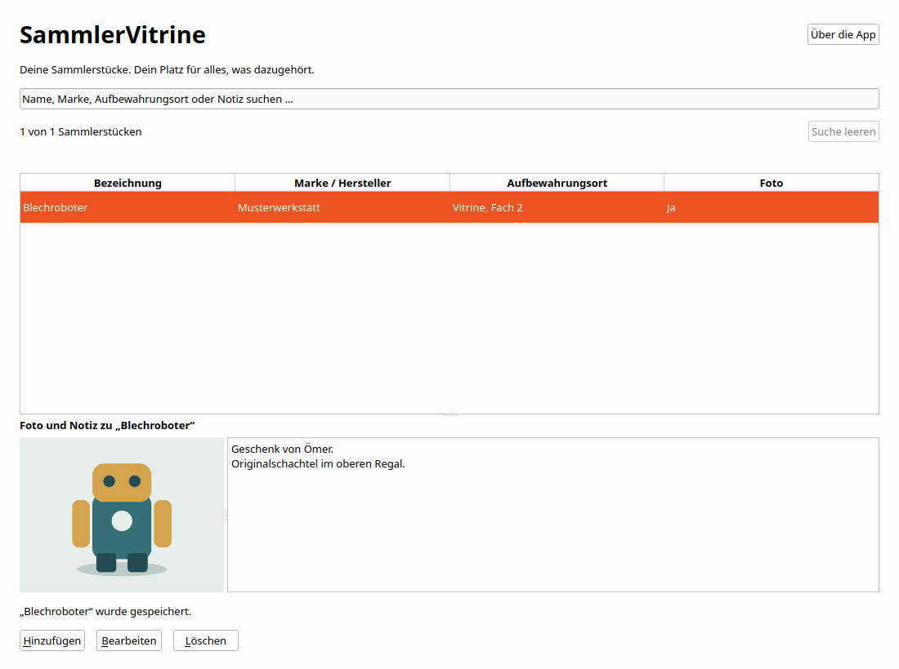

# Collection Showcase

## Linux-Anwendungsmenü und Dock

Nach dem Entwicklungsbuild registriert dieser Befehl die App im aktuellen
Benutzerkonto:

```bash
python3 scripts/install_desktop.py --development
```

Danach erscheint **Collection Showcase** mit dem eigenen Icon im Anwendungsmenü und Dock.
Der Menüeintrag startet den vorhandenen Entwicklungsbuild über
`scripts/launch.sh`. Dieser baut nichts neu. `scripts/run.sh` baut weiterhin
und startet anschließend die App. Bei fehlendem Build zeigt der Starthelfer
eine Fehlermeldung auf stderr.

Der Installer schreibt ausschließlich den eigenen Desktop-Eintrag und Icons
unter `$XDG_DATA_HOME`, standardmäßig `~/.local/share`. Wiederholtes Ausführen
aktualisiert verwaltete Einträge. Fremde Einträge werden nicht überschrieben.
Die normale Sammlung und Spracheinstellung bleiben erhalten.
`--data-dir /absoluter/testpfad` ist nur für einen ausdrücklich gewünschten
abweichenden Startpfad nötig.

Ein eigenständiges Linux-Paket enthält denselben Installer. Im Paketordner
genügt `python3 install_desktop.py`. Alternativ ist
`python3 scripts/install_desktop.py --app-dir /absoluter/paketpfad` möglich.
Dabei verweist der Menüeintrag auf `CollectionShowcase.sh` und die paketierte Laufzeit.

Die bestehenden Motive bleiben unverändert. Zusätzliche PNG-Größen können
mit `python3 scripts/prepare_icons.py` erzeugt werden. Dafür ist Python mit
Pillow erforderlich, für Installation und App-Start nicht.

## Sammlung, Information und Sprache

Hinzufügen steht oben rechts. Unter der Tabelle stehen Bearbeiten und Löschen.
Die Spaltenüberschriften sortieren auf- und absteigend. Textspalten verwenden die
aktuelle Sprache und eine natürliche Zahlenreihenfolge. Die Auswahl bleibt erhalten.

Info enthält getrennte Fenster für Über die App, Datenschutz und Lizenzen.
Alle Inhalte sind offline verfügbar. Neue Installationen verwenden die unterstützte
Systemsprache mit Englisch als Fallback. Gespeicherte Sprachwahlen bleiben erhalten.

Exportieren sichert die gesamte gespeicherte Sammlung als JSON mit eingebetteten
Originalfotos. Importieren ergänzt
fehlende Exemplare nach Bestätigung. Vorhandene Einträge werden nicht überschrieben.
Erneuter Import derselben Datei legt keine zusätzlichen identischen Exemplare an.
Exportdateien enthalten keine Spracheinstellung oder internen Eintrags-IDs.

Eine Transferdatei darf höchstens 256 MiB und 10.000 Einträge enthalten.
Die bisherigen Fotogrenzen bleiben bestehen. Maximal eine Million Zeichen je Textfeld. Die Grenze verändert vorhandene Daten nicht.
Ein unvollständiger Import wird niemals gespeichert. Dateien anderer Apps und
unbekannte Formatversionen werden abgewiesen. JSON-Dateien sind nicht verschlüsselt.

Auf macOS wählst du erst einen Ordner und dann einen Dateinamen. Auf anderen
Plattformen öffnet sich der Speicherdialog. Vorhandene Dateien werden erst nach
Bestätigung und erneuter Prüfung ersetzt. Datenträger ohne Hardlinks werden für
neue Dateien unterstützt. Bei hartem Abbruch kann dort eine unvollständige neue
Datei zurückbleiben. Erstelle den Export dann erneut unter einem neuen Namen.


Deine Figuren und Sammlerstücke an einem Ort. Erfasse eine Bezeichnung, optional
Marke oder Hersteller, Aufbewahrungsort und eine mehrzeilige Notiz. Genau ein
optionales Foto hilft beim Wiedererkennen. Die Sammlung bleibt vollständig lokal,
ohne Konto oder Internet und unabhängig von der ursprünglichen Bilddatei.



Version 0.1.0 ist die zweite kleine C++-App des Hobby-Portfolios und ein
nachvollziehbares Bewerbungsprojekt. Veröffentlichungsziele sind ausdrücklich
**zuerst Microsoft Store und später Mac App Store für Mac-Computer**.
Die App wurde noch nicht veröffentlicht oder bei einem Store eingereicht.

## Entwickeln und starten

C++20, CMake ab 3.25, Ninja und Qt **6.8.3** mit Core, Gui, Widgets, Sql,
Test, LinguistTools, QSQLITE und JPEG-Plugin. PNG ist im verwendeten Qt Gui eingebaut.
Alle Qt-Komponenten müssen aus derselben SDK-Version und Compiler-ABI stammen.
Lokal geprüft: Ubuntu 24.04.4 x64, GCC 13.3.0, CMake 4.4.4, Ninja 1.11.1,
clang-format 23.1.3 und clang-tidy 22.1.8. Keine zusätzliche Bildbibliothek
wird von der Anwendung direkt eingebunden.

Linux und macOS:

```bash
export SAMMLERVITRINE_QT_ROOT=/absoluter/pfad/Qt/6.8.3/gcc_64
source scripts/env.sh
cmake --preset dev
cmake --build --preset dev --parallel 4
bash scripts/run.sh --data-dir /tmp/sammlervitrine-test
```

Auf macOS zeigt der SDK-Pfad auf `macos`. Der Launcher liegt in
`build/dev/sammlervitrine.app/Contents/MacOS/sammlervitrine`.
Unter Linux startet `build/dev/sammlervitrine` die normale Sammlung.
Für native Linux-Dateidialoge wählt die App standardmäßig das GTK3-Plattformthema.
Eine ausdrücklich gesetzte `QT_QPA_PLATFORMTHEME`-Auswahl hat Vorrang. Die Windows- und macOS-Plattformen verwenden ihre
Systemdialoge. Ohne verfügbaren Plattformhelfer bietet Qt einen Dateidialog an.

Windows in einer x64-Developer-PowerShell von Visual Studio 2022:

```powershell
$env:SAMMLERVITRINE_QT_ROOT = 'C:\Qt\6.8.3\msvc2022_64'
$env:CMAKE_PREFIX_PATH = $env:SAMMLERVITRINE_QT_ROOT
$env:PATH = "$env:SAMMLERVITRINE_QT_ROOT\bin;$env:PATH"
cmake --preset dev
cmake --build --preset dev --parallel 4
.\build\dev\sammlervitrine.exe
```

Maschinenspezifische Werkzeugpfade dürfen in `.tools/env.sh` stehen. Diese Datei
ist ignoriert. Ein lokal installiertes SDK darf von mehreren Projekten verwendet
werden. Die fertige App und ihre Pakete benötigen weder ein SDK noch andere Apps.

## Bedienung

Die Oberfläche unterstützt Deutsch, Englisch, Spanisch, Französisch,
Italienisch und brasilianisches Portugiesisch. Beim ersten Start folgt sie der
Systemsprache, mit Englisch als Rückfall. Unter „Sprache“ lässt sich die Auswahl
speichern. Sie gilt beim nächsten Start. Texte, Datenbank und Fotos bleiben erhalten.
Eigene Dialoge und Qt-Kontextmenüs folgen der App-Sprache. Bedienelemente nativer
Dateiauswahldialoge können der Betriebssystemsprache folgen.

„Hinzufügen“ und „Bearbeiten“ verwenden denselben Dialog. Nur die Bezeichnung
ist erforderlich. Gleichnamige Sammlerstücke besitzen unabhängige IDs. Die Suche
berücksichtigt alle vier Textfelder, Groß- und Kleinschreibung, Umlaute sowie
zusammengesetzte und zerlegte Unicode-Schreibweisen. „Suche leeren“ zeigt alles.

„Foto hinzufügen“ öffnet die native Dateiauswahl. „Foto ersetzen“ tauscht das
Foto im Entwurf aus. „Foto entfernen“ entfernt es zunächst nur im Entwurf.
Erst „Speichern“ übernimmt Texte und Bild zusammen. Ein gespeichertes Foto
bleibt nach Verschieben oder Löschen der Quelle und nach App-Neustart erhalten.
Die Quelle wird niemals verändert. Löschen eines Eintrags verlangt eine Bestätigung
und entfernt auch dessen Foto aus der Sammlung.

Erlaubt sind JPEG und PNG bis **10 MiB**, **6000 Pixel je Seite** und insgesamt
**16 Millionen Pixel**. Der Inhalt zählt, nicht die Dateiendung. Beschädigte,
animierte PNG- und nicht unterstützte Dateien werden abgewiesen. Ungültiger
Import und Speicherfehler erhalten den bisherigen Text- und Fotoentwurf.
Die Vorschau bleibt proportional. EXIF-Orientierung wird vom Qt-Decoder angewendet.
Es gibt weder Galerie noch Bildbearbeitung, OCR oder Bilderkennung.

Abbrechen, Escape und Fensterschließen fragen bei ungespeicherten Änderungen nach.
„Weiterbearbeiten“ ist vorausgewählt. Das gilt auch bei ausschließlichen
Fotoänderungen und beim Schließen des Hauptfensters. Unveränderte Dialoge schließen
sofort. Während eines Imports oder Speicherns sind konkurrierende Aktionen gesperrt.

| Taste | Aktion |
| --- | --- |
| Strg+N / Cmd+N | Hinzufügen |
| Strg+F / Cmd+F | Suche auswählen |
| Strg+, / Cmd+, | Sprachwahl öffnen |
| Enter oder Doppelklick in der Tabelle | Bearbeiten |
| Entf in der Tabelle, Cmd+Rücktaste auf macOS | Löschbestätigung |
| Strg+S / Cmd+S | Entwurf speichern |
| Escape | Dialog abbrechen, gegebenenfalls mit Rückfrage |
| Enter im Notizfeld | Neue Zeile |
| Tab / Umschalt+Tab | Nächstes / vorheriges Bedienelement |

Unter Linux und Windows zeigen Alt-Tastenkürzel die beschrifteten Aktionen.
Formulare scrollen bei kleinen Fenstern oder großer Schrift. Speichern und
Abbrechen bleiben außerhalb des scrollenden Formulars erreichbar.

## Daten und Sicherung

App-ID: `de.appfabrik.sammlervitrine`. Die eigene Datei `sammlervitrine.sqlite3`
enthält Texte und Foto-BLOBs. QStandardPaths bestimmt das persönliche Verzeichnis.
„Über die App“ zeigt den tatsächlich verwendeten Pfad.

| System | Normaler Pfad ohne Store-Sandbox |
| --- | --- |
| Linux | `$XDG_DATA_HOME/de.appfabrik.sammlervitrine`, sonst `~/.local/share/de.appfabrik.sammlervitrine` |
| Windows | `%LOCALAPPDATA%\de.appfabrik.sammlervitrine` |
| macOS | `~/Library/Application Support/de.appfabrik.sammlervitrine` |

Der auf dem Entwicklungsrechner ermittelte Linux-Pfad steht im Prüfbericht.
Windows-Paketvirtualisierung und macOS-Sandbox benötigen eine native Pfadprüfung.
Nutzerdaten liegen niemals im Quell- oder Programmverzeichnis. Es gibt keine
Übernahme von BrettspielRegal-Daten. Eine zweite Instanz derselben Sammlung wird
abgewiesen. Gleichzeitige Bearbeitung durch externe Programme wird nicht unterstützt.

Zum Sichern die App schließen und die SQLite-Datei kopieren. Die optionale
`language.txt` daneben enthält nur die Sprachwahl und kann mitgesichert werden. `collection.lock`
ist keine Nutzerdatenbank. Entfernte Bilder können intern wiederverwendbaren
freien Platz hinterlassen. Sofortige Dateiverkleinerung und sichere physische
Datenlöschung werden nicht zugesagt.

`--data-dir` muss absolut und nicht leer sein. Ein ungültiger Testpfad fällt
niemals auf die normale Sammlung zurück. Tests verwenden ausschließlich
temporäre Datenbanken und generierte Bilder.

```bash
bash scripts/check.sh
ASAN_OPTIONS=detect_leaks=1:halt_on_error=1 UBSAN_OPTIONS=halt_on_error=1 bash scripts/check.sh asan
```

## Aufbau und Portfolio

[Architektur und Interviewerklärung](docs/architecture.md),
[tatsächlich ausgeführte Prüfungen](docs/verification.md),
[Paketierung und spätere Store-Schritte](docs/packaging.md),
[Internationalisierung und Vorschauordner](docs/internationalization.md) sowie
[Komponenten- und Lizenzhinweise](THIRD_PARTY_NOTICES.md) beschreiben die Umsetzung.

| Stufe | Eigenständige App | Genau eine neue Hauptfunktion |
| --- | --- | --- |
| 1 | BrettspielRegal | Einträge anlegen, bearbeiten, löschen und suchen |
| 2 | Collection Showcase | Ein Foto pro Eintrag |
| 3 | ModellbauProjekt | Projektstatus |
| 4 | HolzwerkProjekt | Checkliste |
| 5 | RestaurierungsHeft | PDF-Export |

Jede weitere App behält die Grundfunktionen der vorherigen Stufe. Collection Showcase
bleibt ausschließlich Stufe 2. FactoryForge und PDF Batch Studio sind separate,
größere Projekte. Es gibt keinen gemeinsamen Runtime-Kern oder kopierte Git-Historie.

## JSON-Austauschformat

Formatkennung `collection-showcase.collection`, Version `1`, Eintragsliste `items`.
Jeder Eintrag enthält `name`, `maker`, `location`, `note` und `photoBase64`.
Ohne Foto ist `photoBase64` null, sonst enthält es die ursprünglichen Bildbytes
als kanonisches Base64. Interne Eintrags-IDs sind nicht Bestandteil des Formats.
Dateien anderer Produkte, unbekannte Versionen und ungültige Felder werden
abgewiesen. Der bestätigte Import verwendet einen bereits validierten Snapshot.

## Optionale Farbauswahl

Wie in Yarn Box ab der zweiten Java-App besitzt jeder Eintrag eine optionale
Farbe. Im Editor öffnet „Farbe auswählen“ den Farbdialog mit Palette, eigener
Farbe und Transparenz. Erst Bestätigen übernimmt die Auswahl in den Entwurf.
„ד entfernt sie. Erst Speichern übernimmt den gesamten Entwurf in die Sammlung.
Abbrechen und Schließen schützen auch Änderungen ausschließlich an der Farbe.

Die Tabelle zeigt ein Farbfeld und den Hexcode. Sie lässt sich nach Farbe
sortieren. Auch die Suche berücksichtigt den Code. Transparenz ist am
Schachbrettmuster erkennbar. Die Auswahl ist in allen sechs Sprachen verfügbar.

Farben werden als `#RRGGBB`, bei Transparenz als `#RRGGBBAA` gespeichert.
Keine Farbe entspricht einer leeren Zeichenfolge. JSON-Exporte enthalten das
Feld `color`. Bisherige Exporte ohne dieses Feld bleiben importierbar.
Neue Exporte benötigen zum Import die aktualisierte App. Unterschiede in der
Farbe gelten beim ergänzenden Import als unterschiedliche Einträge.

Vorhandene lokale Datenbanken werden nach Prüfung ihrer Identität und Struktur
atomar von Schema 1 auf Schema 2 erweitert. IDs, Texte, Originalfotos und alle
vorhandenen Status- und Checklistendaten bleiben erhalten. Die Farbauswahl ist
zunächst leer. Ältere App-Builds können Schema 2 nicht öffnen.
