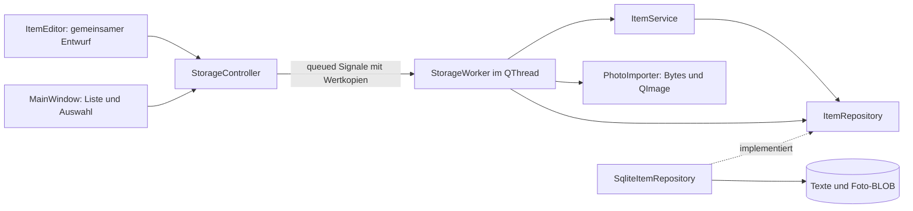

# Architektur und Bewerbungsgespräch

SammlerVitrine besteht aus einem CMake-Projekt mit kleinen internen Targets für
Modell/Service, Fotoimport, SQLite und Oberfläche. Diese Targets werden nur in
SammlerVitrine verwendet. Qt wird dynamisch eingebunden. Das bewährte
BrettspielRegal-Muster wurde app-lokal angepasst, GarnBox diente als fachliches
Vorbild für genau ein Foto. Es gibt weder Plugin-Architektur noch Portfolio-Core.

## Modell und stabile Identität

`ItemDraft` enthält vier QString-Werte und ein QByteArray für das optionale Foto.
Leere Bytes bedeuten kein Foto. QByteArray verwendet Copy-on-write, Wertkopien
können sich daher ohne gegenseitige Mutation über Threadgrenzen bewegen.
`Collectible` ergänzt eine numerische 64-Bit-ID und `hasPhoto`.
Die ID entsteht durch `INTEGER PRIMARY KEY AUTOINCREMENT`. Namen dürfen doppelt
vorkommen. Bearbeitung und Löschen verwenden ausschließlich die ID.

Die Listenabfrage liefert leichte Collectible-Werte mit leeren Fotobytes und
separatem `hasPhoto`. Nur die Detailabfrage `find(id)` liefert den vollständigen
Datensatz. Vor Bearbeitung eines markierten Fotos müssen Detailabfrage und
Decodierung erfolgreich sein. Ein Fehler öffnet keinen Editor. Dadurch kann
ein fehlgeschlagener Fotozugriff niemals als absichtliches Entfernen gespeichert
werden. Nach erfolgreichem Speichern entfernt MainWindow die Bytes aus seiner
Listenkopie. Es hält nicht sämtliche Bilder der Sammlung im Arbeitsspeicher.

Einzeilige Texte werden außen mit Unicode-Leerraumerkennung bereinigt. Die
Bezeichnung darf danach nicht leer sein. Die Notiz bleibt einschließlich
Leerzeilen und Einrückung erhalten. Qt-Texteditoren verwenden die übliche
LF-Darstellung. Die Suche normalisiert nach NFC, wendet Unicode-Case-Folding
an und normalisiert erneut. Ein QCollator der aktiven App-Sprache mit natürlicher
Zahlensortierung und der ID als Gleichstandsregel liefert stabile Reihenfolge.
Die lineare Textsuche passt zum bewusst kleinen Sammlungsumfang.

## Fotoimport und begrenzter Speicher

Die native Dateiauswahl liefert einen temporär benötigten Pfad. Abbrechen
ändert nichts. Der Worker öffnet ausschließlich lesend und liest höchstens
10 MiB plus ein Prüfbyte in begrenzten Blöcken. Die zusätzliche Grenze beim
Lesen verhindert eine Umgehung durch nachträgliches Dateiwachstum.

QImageReader erkennt den Inhalt ohne Vertrauen in die Endung. Nur JPEG und PNG
werden angenommen. Vor vollständigem Decodieren werden Breite, Höhe und
64-Bit-Pixelprodukt geprüft. Grenzen sind 6000 Pixel pro Seite und 16 Millionen
Pixel insgesamt. PNG-Chunklängen, CRCs und abschließender IEND werden geprüft.
Animierte PNGs werden abgewiesen. JPEG muss vollständig eingerahmt sein.
Da der Qt-JPEG-Decoder beschädigte Daten teilweise mit einer Warnung repariert,
wertet ein mutexgeschützter Diagnose-Scope Decoderwarnungen im aktuellen Thread
als Fehler. Andere Qt-Meldungen werden an den vorherigen Handler weitergeleitet.
Die App installiert keine konkurrierenden Diagnose-Handler.

Erst nach vollständigem Decodieren entsteht eine verkleinerte QImage-Vorschau
mit höchstens 1000 Pixeln pro Seite. Die Originalbytes bleiben unverändert.
`setAutoTransform(true)` berücksichtigt die vom Decoder erkannte Orientierung.
Die Anzeige zeichnet proportional in einen passenden Zielbereich. QPixmap wird
hier nicht benötigt. Die Bilddatenprüfung bleibt von Widgets getrennt.

Der Pixeldeckel begrenzt das vollständige Bild auf etwa 64 MiB bei 32 Bit oder
128 MiB bei 64 Bit pro Pixel, zusätzlich zu Decoderpuffern, Bytes und Vorschau.
Qt kann aufgrund seines eigenen Allokationslimits ein Bild früher ablehnen.
Die App ist kein Sicherheits-Sandbox für unbekannte Decoder. Vollständig
syntaktisch gültige, aber inhaltlich veränderte Bilder sind nicht erkennbar.
Es gibt keine besondere Farbprofilaufbereitung, Bearbeitung oder Qualitätsänderung.

## Gemeinsamer Entwurf und atomarer Abschluss

1. ItemEditor hält den ursprünglichen Stand und den aktuellen Text-/Fotozustand.
   Gleichheit vergleicht die Bytes, nicht Dateiname oder Pfad.
2. Import und Vorschau müssen beide erfolgreich sein, bevor sie das Entwurfsfoto
   ersetzen. Ungültige Importe erhalten alle bisherigen Eingaben.
3. Speichern validiert den Entwurf. Ein queued Signal übergibt eine Wertkopie
   an den einzelnen Worker. Gleichzeitiges Importieren oder Speichern ist gesperrt.
4. ItemService wählt anhand der ID zwischen Anlegen und Ändern. Das Repository
   bindet Texte und nullable Foto-BLOB an eine vorbereitete SQL-Anweisung.
5. Eine explizite SQLite-Transaktion umschließt die Mutation. Ein RAII-Objekt
   führt bei jedem vorzeitigen Ausgang Rollback aus, auch nach Commit-Fehler.
6. Erst nach erfolgreichem Commit wird der bestätigte Datensatz signalisiert.
   MainWindow aktualisiert seine Textliste direkt, ohne eine zusätzliche
   fehleranfällige Nachleseoperation. Der Editor schließt erst jetzt.
7. Bei Fehler bleibt der vollständige Entwurf offen. Derselbe Entwurf kann
   erneut gespeichert werden. Rückfragen auf sämtlichen Abbruchwegen verwenden
   „Weiterbearbeiten“ als sichere Standard- und Escape-Aktion.

Ein BLOB in derselben Zeile vermeidet verwaiste Fotodateien und Abstimmung
zwischen Dateisystem und Datenbank. DELETE entfernt die Zeile samt Foto.
Eine externe Quelle wird weder nach dem Import benötigt noch verändert.

## RAII, Ownership und Threadgrenzen

Qt-Parent-Ownership verwaltet Widgets. MainWindow hält seinen Editor als QPointer.
StorageController besitzt einen QThread als Member. Ein QObject-Worker wird
vor Arbeitsbeginn in diesen Thread verschoben und am Threadende dort freigegeben.
Sein `std::unique_ptr<ItemRepository>` erzeugt und zerstört die SQL-Verbindung
im Worker. Jede QSqlQuery bleibt lokal. Beim Abbau werden zuerst Abfragen und
Verbindungshandles freigegeben, dann die benannte Qt-Verbindung entfernt.

Alle Datenbank-, Import- und Decoderarbeiten laufen seriell im Worker. Der
GUI-Thread ändert ausschließlich Widgets. Er bleibt auch während des auf zwei
Sekunden begrenzten SQLite-Sperrwartens ansprechbar. Im normalen Ablauf verhindert
die App das Beenden während einer Mutation. Der Controller-Destruktor beendet
den Thread geordnet und wartet auf einen noch laufenden Aufruf.

Jeder Auswahlwechsel erhöht einen Generationstoken. MainWindow übernimmt nur
Ergebnisse zur aktuellen Generation. Alte Erfolge und Fehler können keine
neuere Auswahl überschreiben. Editorimporte erhalten eigene Tokens. Alle
Callbacks besitzen einen QObject-Empfängerkontext. Zerstörte Fenster oder Dialoge
werden daher nicht mehr aufgerufen. QImage und QByteArray gehen als Werte über
die Grenze. Lange Warteschlangen bei sehr schnellem Wechsel sind möglich,
führen aber nicht zu falschen Bildern. Das ist eine bewusste kleine Lösung
mit einem Worker statt zusätzlicher Threadpools.

## Schema und Fehler

Schema 1 enthält `items(id,name,maker,location,note,photo)`.
`PRAGMA user_version=1` und die app-eigene `application_id=1398166612` kennzeichnen
die Datenbank. Nur eine vorher nicht existierende Datei wird initialisiert.
Vorhandene leere, beschädigte, fremde und unbekannt neuere Datenbanken werden
abgewiesen. Integritätsprüfung und erwartete Spalten/Typen sichern den Start ab.
Auch beim Lesen aus SQLite wird die BLOB-Größe vor Materialisierung begrenzt.

QStandardPaths bestimmt den Benutzerpfad. Ein QLockFile im kanonischen
Datenverzeichnis verhindert eine zweite schreibende App-Instanz. Pfadfehler,
fehlende Rechte, belegter Datenträger, SQL-Sperren und Lesefehler erhalten eigene
Hinweise. Es gibt keinen stillen Ersatz durch eine leere Sammlung.

## Sprache und Einstellungen

Das interne Target `item_i18n` enthält sechs App-Kataloge und die passenden
Qt-Basisübersetzungen als Ressourcen. `Translations` installiert sie vor dem
Start der Fenster und des Workers. Der aktive Katalog bleibt während des
Prozesses unverändert. `QLocale` steuert Sortierung und Zahlenformat.
Nicht unterstützte Sprachen fallen auf Englisch zurück.

`language.txt` liegt neben der Datenbank. Gelesen werden höchstens 128 Bytes.
Fehlende Einstellungen bedeuten automatische Sprachauswahl, fehlerhafte
Einstellungen führen zu Englisch und einem Hinweis. Der vorhandene Worker
speichert Änderungen über `QSaveFile` atomar. Ein Schreibfehler erhält die alte
Einstellung und die Auswahl im Dialog. Die Änderung gilt beim nächsten Start.
Eine Änderung der SQLite-Datei, ihres Schemas oder der Foto-BLOBs ist dafür
nicht erforderlich.

## Nachweise

Qt Test prüft die Fachregeln ohne Widgets, echte temporäre SQLite-Dateien und
generierte Bilder. Externe SQLite-Verbindungen erzeugen Schreib- und Commit-Sperren.
Ein Repository-Decorator kontrolliert Verzögerungen und Fehler, um Threadgrenzen,
Doppelaktionen, Auswahlwechsel und zerstörte Empfänger reproduzierbar zu prüfen.
Sichtbare X11-Abläufe mit nativen GTK-Dateidialogen ergänzen diese Tests.
Die konkreten Ergebnisse stehen im [Prüfbericht](verification.md).

Offizielle Grundlagen: [QImageReader](https://doc.qt.io/qt-6.8/qimagereader.html),
[Qt-SQL und Threads](https://doc.qt.io/qt-6.8/threads-modules.html#threads-and-the-sql-module),
[QByteArray-Wertsemantik](https://doc.qt.io/qt-6.8/implicit-sharing.html) und
[Qt-Objektlebenszyklen](https://doc.qt.io/qt-6.8/objecttrees.html).
